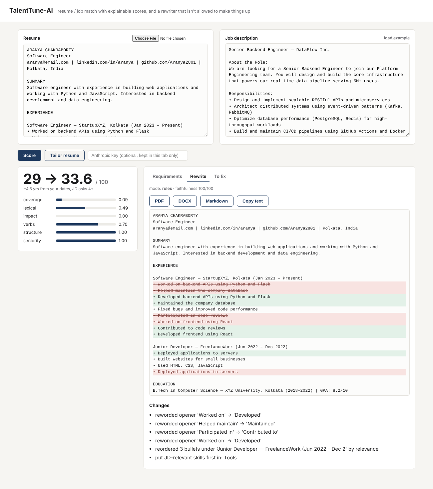

# TalentTune-AI

Resume ↔ job description matching that explains itself, plus a resume rewriter
that gets fact-checked before you see its output.



[](https://github.com/Aranya2801/TalentTune-AI/actions/workflows/ci.yml)

## Why this exists

The first version of this repo was the usual "paste resume + JD, ask an LLM to
optimise it, show an ATS score" app. Two things bothered me once I looked closer:

1. **The score was easy to game.** It counted JD keywords anywhere in the text. If
   you pasted the whole JD skill list into a resume that had nothing to do with the
   job, that resume beat the real match about 70% of the time (numbers below).
2. **The rewriter made things up.** It was told "never fabricate", and in the same
   prompt it was told to "add missing ATS keywords" and "add measurable impact". You
   can guess which instruction won. Invented percentages, skills copied from the JD,
   "Engineer" turning into "Senior Engineer".

So v0.3 is a rewrite around two ideas:

- **Evidence-weighted matching.** It matters *where* a skill shows up. "Moved 9
  services to Docker" is evidence; "Docker" in a comma-separated skills list is a
  claim. Each JD requirement gets credit based on the strongest evidence for it, and
  every number in the report points back to a line in the resume.
- **A fact-check loop around the LLM.** Every rewrite is compared with the original
  for new numbers, new skills, title/scope inflation, changed dates or employers and
  bullets that don't come from anywhere. If something is found, the model gets one
  chance to fix it; whatever is still wrong after that is reverted to the original
  line. Anything that needs real facts (a missing metric, a skill you haven't shown)
  becomes a suggestion for *you* instead.

It also works without an API key: scoring is fully deterministic, and there's a
rule-based rewriter that only reorders and rewords (it can't add facts by design).

## Quick start

```bash
git clone https://github.com/Aranya2801/TalentTune-AI.git
cd TalentTune-AI
python -m venv .venv
.venv\Scripts\activate          # Windows (PowerShell)
# source .venv/bin/activate     # macOS / Linux
pip install -r requirements-dev.txt
```

Web app:

```bash
uvicorn talenttune.api.app:app --reload
# open http://localhost:8000 and click "load example"
```

Command line:

```bash
python -m talenttune score  --resume examples/resume.txt --jd examples/job_description.txt
python -m talenttune tailor --resume my_cv.pdf --jd job.txt -o tailored.docx
python -m talenttune check  --original my_cv.txt --rewritten something_chatgpt_wrote.txt
```

`check` is handy on its own: run it on any AI-edited resume before you send it.

For LLM rewriting set `ANTHROPIC_API_KEY` (see `.env.example`), or paste a key into
the web UI. Docker: `docker compose up --build`.

## What the score looks like

```
Match score: 29.0/100

  coverage   ##.................. 0.09
  lexical    ##########.......... 0.49
  impact     .................... 0.00
  verbs      #####............... 0.25
  structure  #################### 1.00
  seniority  #################### 1.00

Requirements:
  ~  AWS                          w=1.0  ev=0.35  [skills list]
  -- Kafka / RabbitMQ             w=1.0  ev=0.00
  ok Python                       w=1.0  ev=1.00  [experience bullet]
  ...
```

| component | weight | what it measures |
|---|---|---|
| coverage | 0.45 | JD requirements, weighted by section (required 1.0, responsibilities 0.8, nice-to-have 0.4), times the evidence for each |
| lexical | 0.15 | cosine similarity of the two texts (sublinear tf), rescaled |
| impact | 0.15 | share of bullets with a real number in them (dates don't count) |
| verbs | 0.10 | bullets that start with what you did vs "worked on / helped / responsible for" |
| structure | 0.10 | sections present, contact info, length |
| seniority | 0.05 | years from your date ranges (overlaps merged) vs "N+ years" in the JD |

Evidence weights: experience bullet 1.0, project bullet 0.85, summary 0.45, skills
list 0.35. Implied skills get half credit (FastAPI → Python, Helm → Kubernetes). A
bullet that is mostly a list of tool names is treated like a skills list.

JD parsing handles a few things keyword extractors usually get wrong: benefits and
"about us" sections are ignored, "Kafka or RabbitMQ" is one requirement either skill
satisfies, and "AWS (EC2, S3, Lambda)" counts the bracketed items as examples of AWS
rather than three more hard requirements.

A note on the word "ATS": real applicant tracking systems mostly store and search
resumes; there isn't one universal "ATS score". This is a match score with its
reasoning attached, not a simulation of Workday.

## Experiments

The first two run offline and take a minute or two:

```bash
python experiments/ranking.py         # -> experiments/results/ranking.md
python experiments/grounding_eval.py  # -> experiments/results/grounding.md
python experiments/llm_tailoring.py   # needs an API key -> results/llm_tailoring.md
```

The benchmark is small and hand-made: 10 resumes and 8 JDs across backend, ML, data,
frontend, DevOps and Android, with graded relevance labels I wrote
(`experiments/data/labels.json`). Treat the numbers as a sanity check, not a paper
result. Longer write-up in [docs/REPORT.md](docs/REPORT.md).

**1. Ranking and keyword stuffing.** On clean resumes every method ranks the right
person first (P@1 = 1.0 for all of them), so the interesting part is the attack: take
every resume that does *not* fit a JD, paste in all the JD's skills, and see how often
it now beats the best real match.

| scorer | nDCG@3 | stuffed resume beats the real match (skills list) | (one fake bullet) | (fake bullets, 2 skills each) |
|---|---|---|---|---|
| v1 score (original repo) | 0.892 | 69% | 69% | 69% |
| plain keyword overlap | 0.944 | 61% | 61% | 61% |
| coverage, no evidence weights | 0.944 | 47% | 47% | 47% |
| coverage with evidence weights | 0.957 | 0% | 0% | 86% |
| full score without list detection | 0.922 | 0% | 35% | 0% |
| **full score** | 0.922 | **0%** | **0%** | **0%** |

Evidence weighting is what kills the cheap attacks. The last column is the honest
limit: if someone writes believable fake bullets, coverage alone can't tell (86%).
The full score only holds up there because those fake bullets have no numbers and
start with "Used", and a more careful liar would fix that. Text alone can't verify a
person; that's what interviews are for.

**2. Catching fabricated edits.** Each resume gets one fabrication at a time (345
samples, 7 types) and the checker has to flag it. Faithful edits (350 samples:
rule-based rewrite, synonym paraphrase, merged/condensed/shuffled/dropped bullets)
are used to measure false alarms.

| checks enabled | precision | recall |
|---|---|---|
| numbers only | 1.00 | 0.42 |
| numbers + skills | 1.00 | 0.57 |
| + titles, names, unsupported bullets | 1.00 | 1.00 |

Before you get excited about 1.00: I wrote the perturbations and the checker
together, so this mostly shows the checks do what they were designed for. The
"harder cases" table in `results/grounding.md` is more telling. An extra clause on
a real bullet ("...and presented to senior leadership") gets through every time,
and so does a tool that isn't in the skill taxonomy (it only shows up as a
low-severity note).

**3. Real LLM rewrites.** `llm_tailoring.py` runs the v1 prompt, the new prompt
without the guard, and the full guarded pipeline on the same pairs and counts what
the checker finds in each. I haven't committed results for this one yet because they
depend on the model and cost money to reproduce; run it with your own key.

## Project layout

```
talenttune/
  taxonomy.py      skill list loader + matcher (data/skills.txt, ~130 skills with aliases)
  jd.py            JD -> weighted requirements
  resume.py        resume -> sections, lines, skill evidence, years of experience
  scoring.py       the match report
  grounding.py     fact-checker + revert
  rewrite.py       rule-based rewriter, LLM prompts, suggestions
  pipeline.py      score -> rewrite -> check -> repair -> re-score
  llm.py           Anthropic client (and a scripted fake for tests)
  files.py         pdf/docx/txt in, pdf/docx/md out
  history.py       SQLite run history
  api/app.py       FastAPI app, also serves web/index.html
  cli.py
experiments/       benchmark data + the three experiments
tests/             pytest, no network needed
```

API docs: [docs/API.md](docs/API.md), or `/docs` on a running server.

## Limitations

- The skill taxonomy is hand-written and leans towards software and data roles. A
  nursing or sales JD will mostly fall back to the lexical part of the score.
- English only, and resumes in two-column PDF layouts can come out of `pypdf` in a
  scrambled order. Paste the text if the parse looks wrong.
- The checker compares against the *original resume*. If the original already has
  inflated claims, it can't know.
- The benchmark is tiny and labelled by one person (me).

## Roadmap

- [ ] Embedding similarity as an optional extra signal (and an ablation for it)
- [ ] Bigger benchmark using public resume/JD datasets
- [ ] Detect "tacked-on" claims: new clauses on otherwise faithful bullets
- [ ] Commit results for experiment 3 across a couple of models

## License

MIT
